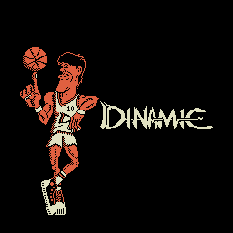
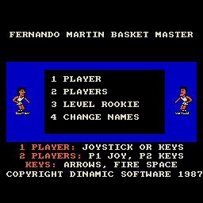
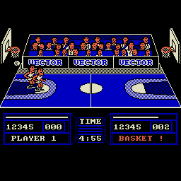
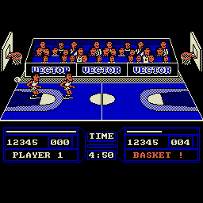

# Fernando Martín Basket Master — порт на Вектор-06Ц

**Fernando Martín Basket Master** (Dinamic, 1987) на ванильном **Векторе-06Ц**: i8080 3 МГц, 64 КБ,
без квазидиска. Версия **0.5a (альфа)**. Игровой код — MSX-версия **Executive**: дизассемблирована,
перенесена на Вектор и переведена с Z80 на КР580ВМ80А. Логика сверена с оригиналом MSX шаг в шаг.
Графика, звук и палитра взяты из версии для Amstrad CPC: площадка, зрители, спрайты игроков, табло,
заставка, музыка и эффекты в четырёх цветах.

| Заставка | Меню |
|---|---|
|  |  |

| Матч | Попадание |
|---|---|
|  |  |

## Готовые образы

| Файл | Что это |
|---|---|
| [`rom/basket.c00`](rom/basket.c00) | **основной**: обычный Вектор (КР580ВМ80А), образ памяти с адреса 0x0000 — на MiSTer (ядро Vector-06C) открывается как `.C00`, в эмуляторах — как `.r0m` |
| [`rom/basket-0100.rom`](rom/basket-0100.rom) | то же в формате `.rom` (загрузка с 0x0100) |
| [`rom/basket-z80.c00`](rom/basket-z80.c00) | версия для Вектора с Z80 (процессорная плата Z80, в Emu80 — платформа `vector.z80`) |
| [`rom/basket-z80-0100.rom`](rom/basket-z80-0100.rom) | то же в формате `.rom` |

Z80-версия — это MSX-код как есть: она играет быстрее оригинала (≈9,2 обновления в секунду против
8,35 у MSX). Основная i8080-версия — около 6,9 в секунду, примерно 80 % темпа MSX.

## Управление

Заставка — **пробел**. В меню:

| клавиша | пункт |
|---|---|
| **1** | матч против компьютера |
| **2** | матч на двоих |
| **3** | уровень сложности (по кругу) |
| **4** | сменить имена игроков |

| | игрок 1 | игрок 2 |
|---|---|---|
| один игрок | джойстик «П» **или** стрелки + пробел | компьютер |
| двое | джойстик «П» | стрелки + пробел (или ВК) |

Огонь — бросок. Выйти из матча в меню — **СС + УС + АР2** (как SHIFT+CTRL+ESC на MSX).
Подсказка по управлению выводится в меню под пунктами.

## Что по-другому, чем на MSX

- **Цвет как у CPC.** Экран Вектора используется в режиме 2+2 плоскости: четыре пера, палитра
  чёрный/белый/синий/розовый, спрайты, площадка с трибунами и табло перенесены с CPC попиксельно.
  Рекламные щиты AMSTRAD заменены на VECTOR.
- **Заставка** — загрузочная картинка CPC с логотипом DINAMIC.
- **Зрители** вскакивают после попадания, как в CPC-версии.
- **Звук** — музыка и эффекты CPC (AY) пересчитаны на ВИ53.
- **Управление** зафиксировано (джойстик «П» и стрелки); пункт меню «5 SELECT CONTROL» убран.
- **Вывод** — свой: кадр собирается по зонам изменений вне экрана и копируется позади луча,
  без разрывов и мерцания. Повтор броска увеличивается вдвое, как в оригинале.

## Известно

- Альфа. На i8080 игра медленнее оригинала (≈80 % темпа MSX); Z80-версия, наоборот, быстрее (ограничителя темпа нет).
- Во время празднования попадания (прыгающие зрители) кадр тяжелее, игра заметно замедляется;
  зрители прыгают около 6 секунд (на CPC — около 3).

## Сборка

Нужны Python 3, Node.js и ассемблер [zasm](https://k1.spdns.de/Develop/Projects/zasm/) 4.5
(в PATH как `zasm` или в переменной `ZASM`). Для тестов — эмулятор
[vector06js](https://github.com/svofski/vector06js) с Z80-ядром (`V06=<путь>`), для сверки с MSX — openMSX.

Материалы оригинала в репозиторий **не входят**: лента MSX Executive, собранный из неё картридж,
блоки загрузки и снимок памяти, лента CPC, диск первой MSX-версии. Для сборки нужна лента
`Fernando Martin Basket Master - Executive (1987)(Dinamic Software)(ES)[a][RUN'CAS-'].cas`
(SHA-256 `0c8577f4…6f70`, см. [`ref/msx/MANIFEST.md`](ref/msx/MANIFEST.md)):

```sh
python3 tools/prepare_orig.py 'путь/к/ленте.cas'   # ref/msx/executive/: блоки, overlay, картридж (сверка SHA-256)
python3 tools/build_v06_rom.py                       # Z80-образ -> build/v06/basket.rom
python3 tools/disasm_v06.py                          # дизассемблирование образа для перевода
python3 tools/recompile_i8080.py                     # перевод Z80 -> i8080
python3 tools/build_i8080_rom.py                     # i8080-образ -> build/i8080/basket-i8080.rom
python3 tools/build_v06_rom.py                       # повтор: синхронизирует карту памяти
python3 tools/verify_refactor.py --profile full      # 38 проверок (без окон и звука)
```

Перевод с Z80 на i8080 и проверки описаны в [`docs/recompilation.md`](docs/recompilation.md) и
[`docs/verification.md`](docs/verification.md), устройство вывода — в [`docs/frame-render.md`](docs/frame-render.md).

## Права

Код порта (адаптер в `src/v06/`, инструменты, документация) — MIT, см. [`LICENSE`](LICENSE).
Игра, её графика, музыка и тексты принадлежат правообладателям Dinamic Software; дизассемблирование,
извлечённая графика CPC и переведённый код включены для некоммерческого изучения и сохранения,
см. [`NOTICE`](NOTICE).

Оригинал: Dinamic Software, 1987 — программирование Paco Martín, Víctor Ruiz, Florentino Pertejo;
графика Julio Martín; музыка Manuel Cubedo.

Порт: Борис Лихачёв, 2026.
